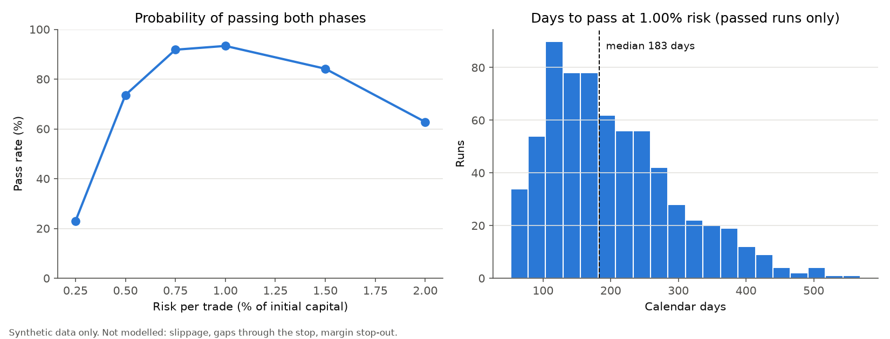

# prop-challenge-simulator

> **CZ:** Projekt ukazuje, jak ověřit, jestli dobrý výsledek testu není jen náhoda – stejný problém
> má jakékoli rozhodovací pravidlo, nejen obchodní.
>
> **EN:** This project shows how to check whether a good test result is more than luck – the same
> problem applies to any decision rule, not just trading.

[Česky](#česky) · [English](#english)

---

## Česky

Simulátor, který na **syntetických** obchodech odhaduje, s jakou pravděpodobností a za jak dlouho
obchodní pravidla splní dvoufázovou challenge prop firmy. Ukázka postupu, jak poctivě testovat
pravidla: náklady správně převedené do R, konzervativní vyhodnocení denního limitu, rolling starty,
náhodný výběr souběžných signálů a interval nejistoty místo jednoho čísla.

### Co to dělá

| Část | Soubor | Popis |
|---|---|---|
| Pravidla challenge | `propsim/rules.py` | Cíle fází (výchozí 10 % / 5 %), denní limit (5 %), statický max. drawdown (10 %), minimum obchodních dní, limit dní na fázi. Vše nastavitelné, nic natvrdo. |
| Simulace portfolia | `propsim/simulation.py` | Den po dni: close a nejhorší bod dne v R, limit souběžných pozic, náhodné pořadí signálů ze stejného dne. Každá fáze začíná s čistým účtem. |
| Denní limit | `run_phase` | Nejhorší equity dne se porovná se **zůstatkem o půlnoci** (jen uzavřené obchody). Vypaření plovoucího zisku tedy není denní ztráta. Limit lze počítat z počátečního kapitálu (`initial`) nebo z půlnočního zůstatku (`midnight_balance`). Porušení a splnění cíle tentýž den = porušení (konzervativně). |
| Rolling starty | `monthly_start_days`, `evaluate` | Challenge se spustí na začátku každého měsíce a každý start se přehraje vícekrát s jiným náhodným výběrem obchodů. |
| Náklady v R | `propsim/costs.py` | `náklad v R = náklad % ceny / vzdálenost stopu % ceny`. Stop 2 % a náklad 0,1 % = 0,05 R, ne 0,001 R. |
| Interval pro avgR | `propsim/bootstrap.py` | Blokový bootstrap po měsících výstupu – obchody ze stejného měsíce nejsou nezávislé. |
| Syntetická data | `propsim/synthetic.py` | Náhodná procházka v R se stopem −1 R, cílem a max. dobou držení. Parametr `drift` = edge, `seed` = reprodukovatelnost. |

Velikost pozice: každý obchod riskuje pevný podíl **počátečního** kapitálu (equity = 1 + riziko × R).

### Jak spustit

```bash
python -m venv .venv
.venv\Scripts\activate            # Linux/macOS: source .venv/bin/activate
pip install -r requirements.txt
python -m pytest
python examples/run_example.py
python examples/run_example.py --drift 0.0
```

Skript vypíše průměrné R s 90% intervalem, pro několik úrovní rizika pravděpodobnost splnění obou
fází, medián dní a důvody neúspěchu, a uloží graf do `examples/output/example.png`.

Ukázkový výstup (výchozí parametry, `seed 42`, avgR +0,29 R):

| riziko/obchod | P(splnění) | medián dní |
|---|---|---|
| 0,50 % | 74 % | 335 |
| 1,00 % | 93 % | 183 |
| 2,00 % | 63 % | 75 |

Jde o syntetická data se zvoleným edge (parametr `drift = 0.03`, což dává průměr +0,29 R na obchod
po nákladech); výsledky ilustrují metodu, ne reálnou strategii.



S `--drift 0.0` (avgR po nákladech −0,02 R, interval −0,09 .. +0,05) projde při riziku 1 % stále
**26 %** běhů – čistě náhodou. Proto je samotná „úspěšnost challenge" bez intervalu pro edge jen slabý důkaz.

### Omezení – co model NEUMÍ

- **Skluzy** – stop i cíl se vyplní přesně na své ceně.
- **Gapy přes stop** – když trh otevře pod stopem, model přesto zaúčtuje −1 R (test
  `test_gap_through_stop_is_filled_at_stop_known_limitation` to výslovně dokumentuje).
- **Margin stop-out / páka** – nepočítá s požadavky na marži ani s nucenou likvidací brokerem.
- Denní data: neví, v jakém pořadí nastal během dne low a high; proto se volí konzervativní varianta.
- Swapy, poplatky za challenge, měnové kurzy, pravidla typu „consistency" nebo zákaz držení přes víkend.
- Syntetický proces nemá režimy trhu ani tlusté chvosty; výsledky jsou ilustrace metody, ne odhad
  pro žádnou reálnou strategii.

Vytvořeno s pomocí AI (Claude Code). Zadání, návrh, kontrola a testování: Jaroslav Kučera.

---

## English

A simulator that estimates, on **synthetic** trades, how likely a set of trading rules is to pass a
two-phase prop-firm challenge and how long it takes. It demonstrates how to test rules honestly:
costs converted to R correctly, a conservative daily-limit check, rolling starts, random selection
among simultaneous signals, and a confidence interval instead of a single number.

### What it does

| Part | File | Description |
|---|---|---|
| Challenge rules | `propsim/rules.py` | Phase targets (default 10 % / 5 %), daily loss limit (5 %), static max drawdown (10 %), minimum trading days, day limit per phase. All configurable, nothing hard-coded. |
| Portfolio simulation | `propsim/simulation.py` | Day by day: close and worst point of the day in R, cap on simultaneous positions, random order of same-day signals. Every phase starts flat. |
| Daily limit | `run_phase` | The day's worst equity is compared with the **balance at midnight** (closed trades only), so evaporating open profit is not a daily loss. The limit is either a share of the initial capital (`initial`) or of the midnight balance (`midnight_balance`). Breach and target on the same day count as a breach (conservative). |
| Rolling starts | `monthly_start_days`, `evaluate` | A challenge starts on the first day of every month; each start is replayed several times with a different random choice of trades. |
| Costs in R | `propsim/costs.py` | `cost in R = cost % of price / stop distance % of price`. A 2 % stop and 0.1 % cost = 0.05 R, not 0.001 R. |
| Interval for avgR | `propsim/bootstrap.py` | Block bootstrap by exit month – trades closed in the same month are not independent. |
| Synthetic data | `propsim/synthetic.py` | Random walk in R with a −1 R stop, a target and a maximum holding time. `drift` = edge, `seed` = reproducibility. |

Position sizing: each trade risks a fixed fraction of the **initial** capital (equity = 1 + risk × R).

### How to run

```bash
python -m venv .venv
.venv\Scripts\activate            # Linux/macOS: source .venv/bin/activate
pip install -r requirements.txt
python -m pytest
python examples/run_example.py
python examples/run_example.py --drift 0.0
```

The script prints the average R with a 90 % interval, then for several risk levels the probability
of passing both phases, the median number of days and the failure reasons, and saves a chart to
`examples/output/example.png`.

Sample output (default parameters, `seed 42`, avgR +0.29 R):

| risk/trade | P(pass) | median days |
|---|---|---|
| 0.50 % | 74 % | 335 |
| 1.00 % | 93 % | 183 |
| 2.00 % | 63 % | 75 |

These are synthetic data with a chosen edge (parameter `drift = 0.03`, giving an average of +0.29 R
per trade after costs); the results illustrate the method, not a real strategy.


With `--drift 0.0` (avgR after costs −0.02 R, interval −0.09 .. +0.05) **26 %** of runs still pass at
1 % risk – by luck alone. A challenge pass rate without an interval for the edge is weak evidence.

### Limitations – what the model does NOT do

- **Slippage** – stops and targets fill exactly at their price.
- **Gaps through the stop** – if the market opens below the stop, the model still books −1 R
  (documented explicitly by `test_gap_through_stop_is_filled_at_stop_known_limitation`).
- **Margin stop-out / leverage** – no margin requirements and no forced liquidation by the broker.
- Daily data: the intraday order of low and high is unknown, so the conservative case is assumed.
- Swaps, challenge fees, currency conversion, "consistency" rules or weekend-holding bans.
- The synthetic process has no market regimes or fat tails; results illustrate the method and are
  not an estimate for any real strategy.

Built with AI assistance (Claude Code). Specification, design, review and testing: Jaroslav Kučera.

---

License: MIT (see [LICENSE](LICENSE))
